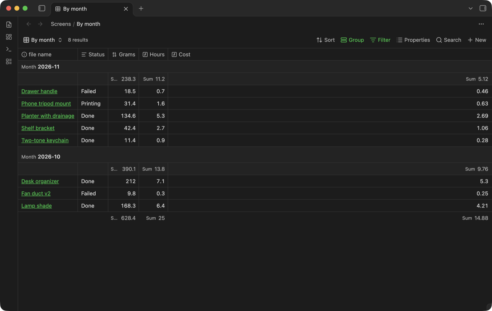
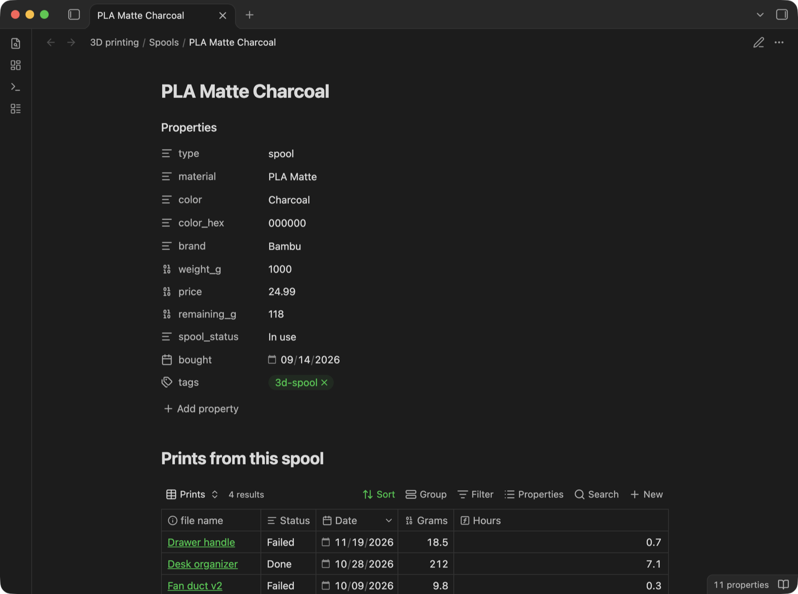
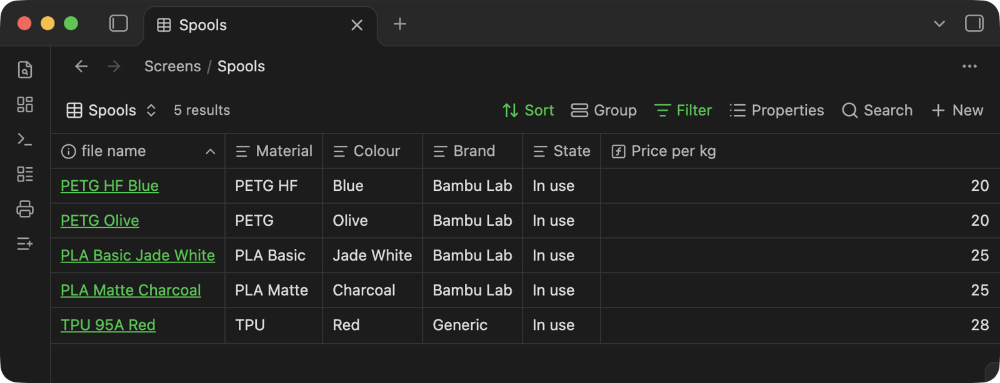
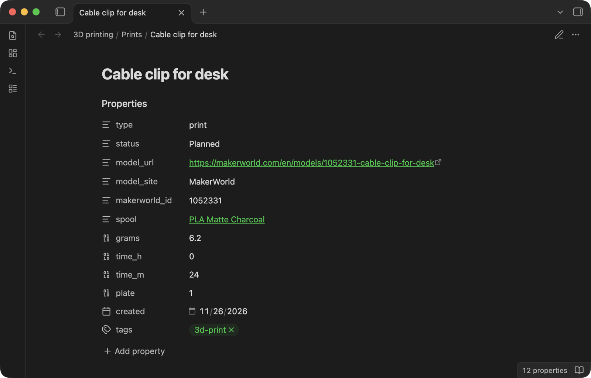
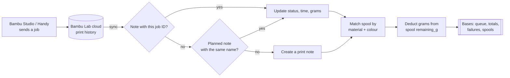

<p align="center">
  
</p>

<p align="center">
  <a href="https://github.com/grissspy/obsidian-bambu-print-sync/releases/latest"></a>
  
  
  <a href="LICENSE"></a>
</p>

<p align="center">
  <b>English</b> · <a href="README.ru.md">Русский</a>
</p>

---

Keep your 3D printing log where the rest of your notes live. **Bambu Print Sync** turns every print into a note, pulls the real time, filament and result from the Bambu Lab cloud, and keeps your spool notes up to date, so a [Bases](https://help.obsidian.md/bases) table can show what is queued, what it cost and how much filament is left.

## Features

| | |
|---|---|
| 🗂 **Print queue** | Plan prints as notes and see them on a board: Planned → Printing → Done / Failed. |
| 📎 **Queue from a link** | Paste a MakerWorld, Printables, Thingiverse or Cults3D link into any note and a planned print appears in the queue. |
| ☁️ **Cloud history** | Imports jobs from your Bambu Lab account: name, status, printer time, grams per filament, plate, printer. |
| 🔗 **Plan ↔ fact** | A job is linked to the planned note by MakerWorld model ID or by name instead of creating a duplicate. |
| 🧵 **Spools** | Finds the spool by material and AMS colour, splits multi-colour prints across spools, and deducts grams once per print. |
| 💸 **Full print cost** | Filament + electricity + printer depreciation + maintenance, written into every print. Pick your Bambu Lab printer model for its typical power draw. |
| ❌ **Failed prints** | The cloud reports the full sliced weight for a cancelled job; the plugin scales it by how far the job got and marks it as an estimate. |
| 🌍 **English and Russian** | Follows Obsidian's language. Status words are configurable. |

## Screenshots

<p align="center"></p>

<p align="center"></p>

<table>
  <tr>
    <td width="50%"><br><sub><b>By month</b>: grams, hours and cost per month.</sub></td>
    <td width="50%"><br><sub><b>Spool note</b>: remaining filament and every print made from it.</sub></td>
  </tr>
  <tr>
    <td width="50%"><br><sub><b>Spools</b>: what is left, price per kg, low-stock warning.</sub></td>
    <td width="50%"><br><sub><b>From a link</b>: a planned print created by pasting a MakerWorld URL.</sub></td>
  </tr>
</table>

<sub>Screenshots use a demo vault with sample data.</sub>

## How it works



Your notes stay plain Markdown with properties. The plugin only reads and writes the properties listed below, and never touches a finished print you have edited.

## Quick start

1. Install the plugin (Community plugins → Browse → *Bambu Print Sync*), or put `main.js` and `manifest.json` from the [latest release](https://github.com/grissspy/obsidian-bambu-print-sync/releases/latest) into `.obsidian/plugins/bambu-print-sync/`.
2. Open the plugin settings, click **Log in** and enter your Bambu Lab email and password. If Bambu sends a code by email, the plugin asks for it.
3. On first start the plugin offers to create the prints and spools folders and the tracker table. Skipped it? Run **Create tracker base** later.
4. Set **Import prints since** to today if you do not want your whole history, and fill in the **Print cost** section (see below).
5. Queue a model by pasting its MakerWorld or Printables link into any note, or run **Add model to queue by link**.
6. Add your spools with **New spool note**, filling `material`, `color_hex`, `price` and `weight_g`.
7. Click the printer icon in the ribbon, or wait for the automatic sync.

### Commands

| Command | What it does |
|---|---|
| Sync prints from Bambu cloud | Imports new jobs, updates running ones, then deducts filament. |
| Deduct filament from spools | Deducts finished and failed prints that have a spool but were not deducted yet. Works for manual notes too. |
| Add model to queue by link | Creates a planned print from a MakerWorld, Printables, Thingiverse or Cults3D link. |
| New print note / New spool note | Creates a note with the right properties in the configured folder. |
| Create tracker base | Writes the Bases file with Queue, All prints, By month, Failed, Cost breakdown and Spools views. |
| Recalculate cost of all prints | Rewrites the cost of every print with the current rates. |
| Log in to Bambu account | Opens the login window. |

## Note properties

<details open>
<summary><b>Print note</b> (<code>type: print</code>)</summary>

| Property | Example | Set by |
|---|---|---|
| `status` | `Planned`, `Printing`, `Done`, `Failed` | you or sync |
| `spool` | `"[[PLA Basic Black]]"` | you, or sync when it finds one match |
| `grams` | `42.4` | you or sync |
| `time_h`, `time_m` | `2`, `40` | you or sync (real runtime once a job ends) |
| `printed` | `2026-11-26` | sync |
| `plate` | `1` | you or sync |
| `filaments` | `PLA #000000 — 42.4 g` | sync |
| `usage` | `"[[PLA Basic Black]]: 30"` | sync, for multi-colour prints |
| `grams_estimated` | `true` | sync, for failed prints |
| `model_url`, `model_site`, `makerworld_id` | `https://makerworld.com/…` | link paste |
| `bambu_task_id`, `bambu_title`, `printer`, `time_est_min`, `source` | | sync |
| `spool_deducted` | `true` | plugin, after deducting |
| `price_kg` | `1990` | you, optional override of the spool price |
| `cost_filament`, `cost_power`, `cost_wear`, `cost` | `1.06`, `0.06`, `0.67`, `1.79` | plugin |

</details>

<details open>
<summary><b>Spool note</b> (<code>type: spool</code>)</summary>

| Property | Example | Notes |
|---|---|---|
| `material` | `PLA Basic` | The first word is matched against the AMS filament type. |
| `color_hex` | `000000` | AMS colour without `#`. Leave empty to match by material only. |
| `weight_g` | `1000` | Filament weight on a full spool. |
| `price` | `1990` | Price of the spool in your currency. |
| `remaining_g` | `870` | Updated by the plugin. |
| `spool_status` | `In use`, `Empty` | Empty spools are never matched. |

</details>

### Matching a job to a planned note

A planned or printing note created from a MakerWorld link is linked by the model ID, which is exact. Otherwise a note is linked when its name matches the job name after both are normalised: lower case, without `.3mf`, `plate N`, underscores and dashes. `Shelf_bracket.3mf` matches a note called `Shelf bracket`. If your note has another name, put the cloud name in `bambu_title`.

### Print cost

Set the rates once in the settings:

| Setting | Example | Used for |
|---|---|---|
| Printer model | Bambu Lab P2S · ~130 W | fills in the average power; edit the watts if you measured yours |
| Electricity price per kWh | `0.18` | `hours × W ÷ 1000 × price` |
| Printer price, lifetime hours | `800`, `4000` | depreciation: `hours × price ÷ lifetime` |
| Maintenance per hour | `0.05` | nozzles, plates, belts, lubricant |
| Currency symbol | `$` | shown on the queue cards |

```
cost = grams × price per kg ÷ 1000            (filament, per spool for multi-colour prints)
     + hours × watts ÷ 1000 × price per kWh   (electricity)
     + hours × (printer price ÷ lifetime hours + maintenance per hour)   (wear)
```

The plugin writes `cost_filament`, `cost_power`, `cost_wear` and `cost` into a print whenever its grams, time or spool change. Once a print is done or failed, its cost stays as it was, so changing your electricity tariff does not rewrite history; run **Recalculate cost of all prints** when you want that. The settings show your machine cost per printing hour. Power values for printer models are typical averages, not measurements.

### Queue from a link

Paste a model link on its own into any note. The plugin recognises MakerWorld, Printables, Thingiverse and Cults3D pages, takes the model name from the URL and creates a planned print with the link. The URL stays where you pasted it; turn on *Replace the pasted link* to get a link to the print note instead. Pasting the same model again does not create a second card while the first is still queued.

The plugin does not download the model page: grams and time come from the cloud sync once you print, or you fill them in after slicing.

## Privacy and network use

This plugin needs a **Bambu Lab account** and talks to the **Bambu Lab cloud** over the internet:

- `api.bambulab.com` (or `api.bambulab.cn` for China accounts) to log in, list your printers and read your print history;
- `bambulab.com/api/sign-in/tfa` only if your account uses two-factor authentication.

Your password is sent to Bambu Lab once to get a token and is **never stored**. The token (valid about three months) is saved in `.obsidian/plugins/bambu-print-sync/data.json` inside your vault, so it travels with your vault sync. No data goes anywhere else: no telemetry, no analytics, no third-party servers.

> [!WARNING]
> The Bambu Lab cloud API is not public or documented by Bambu Lab. It may change or stop working at any time. If login fails, you can paste a token manually in the settings.

## FAQ

**Does it work without the cloud?**
Yes. Create print and spool notes yourself and run *Deduct filament from spools*; the base works the same. LAN-only printers are not synced.

**Will it import my whole history?**
It requests the last 50 jobs by default. Use *Import prints since* to start from a date.

**Does it change my notes after a print is done?**
No. Once a job is final in the note, the plugin leaves it alone, so your corrections stay.

**Can I use my own status words?**
Yes, under *Status names* in the settings. The generated base uses them too.

## Development

The plugin is plain JavaScript with no build step: `main.js` is what Obsidian loads.

```bash
npm test
```

The test runs the sync and deduction logic against a fake vault and a fake cloud. To release, bump `version` in `manifest.json` and `versions.json`, then push a tag with the same number; the workflow attaches `main.js` and `manifest.json` to a GitHub release.

## Disclaimer

Not affiliated with, endorsed by or supported by Bambu Lab. "Bambu Lab" is a trademark of its owner.

## License

[MIT](LICENSE)
