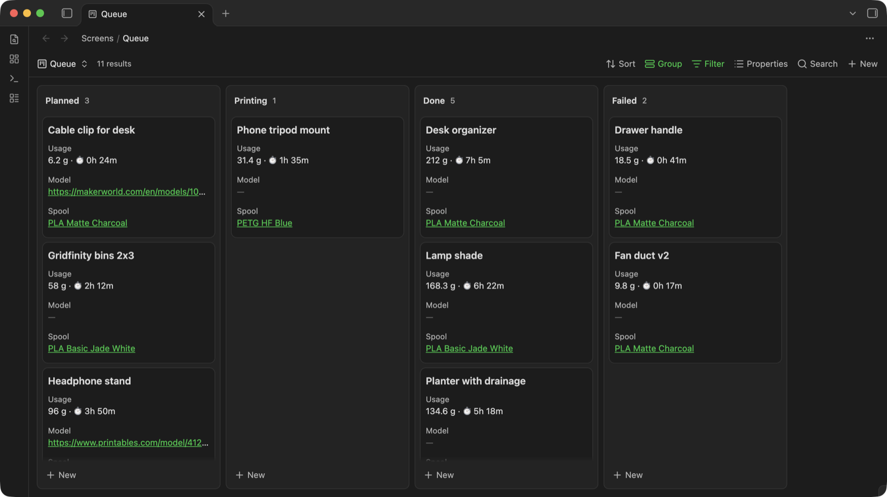
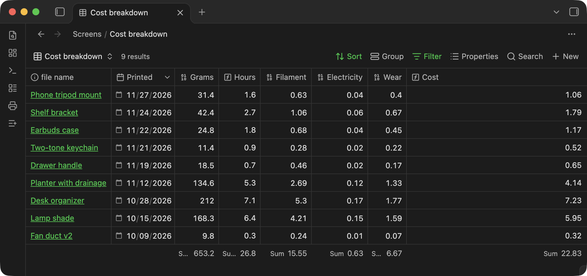
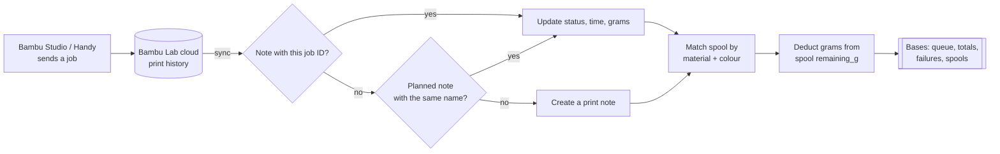

<p align="center">
  
</p>

<p align="center">
  <a href="https://github.com/grissspy/obsidian-bambu-print-sync/releases/latest"></a>
  
  
  <a href="LICENSE"></a>
  <a href="https://boosty.to/grispy/donate"></a>
</p>

<p align="center">
  <b>English</b> · <a href="README.ru.md">Русский</a>
</p>

---

Keep your 3D printing log where the rest of your notes live. **Bambu Print Sync** turns every print into a note, pulls the real time, filament and result from the Bambu Lab cloud, and keeps your spool notes up to date, so a [Bases](https://help.obsidian.md/bases) table can show what is queued, what it cost and how much filament is left.

## Features

| | |
|---|---|
| 🗂 **Print queue** | Plan prints as notes and see them on a board: Planned → Printing → Done / Failed. |
| 📎 **Queue from a link** | Click **Add model** above the board, paste a MakerWorld, Printables, Thingiverse or Cults3D link, and a planned print with the model's picture appears in the queue. |
| 💰 **Spending at a glance** | The print dashboard opens with tiles: spent in total, this month, last month and on failed prints, with print count, kilograms and hours. |
| 🎨 **Spools by colour** | *New spool* shows the material and colour pairs your printer actually used, as colour tiles; pick one, or choose a material from the list and a colour with the colour picker. When adding a model you can pick the spool by colour too. |
| 🖼 **Model pictures** | Cards show the model's picture from its page, or the plate preview from the Bambu cloud after printing. |
| ☁️ **Cloud history** | Imports jobs from your Bambu Lab account: name, status, printer time, grams per filament, plate, printer. |
| 🔗 **Plan ↔ fact** | A job is linked to the planned note by MakerWorld model ID or by name instead of creating a duplicate. |
| 🧵 **Spools** | Finds the spool by material and AMS colour (a colour picked by hand matches when it is close to the AMS colour: two reds do, red and orange do not), splits multi-colour prints across spools (one per colour; a colour without a spool is not deducted), and deducts grams once per print. A spool can be tied to one printer. |
| 💸 **Full print cost** | Filament + electricity + printer depreciation + maintenance, written into every print. Pick your Bambu Lab printer model for its typical power draw. |
| ❌ **Failed prints** | The cloud reports the full sliced weight for a cancelled job. The plugin scales it by how long the job ran against the slicer estimate, counts only the time it really ran, and marks the grams as an estimate (`grams_estimated`). A job cancelled before it started costs nothing; without a slicer estimate the full weight is kept as an upper bound. Warm-up and calibration count as printing, so very early failures are slightly overestimated; fix the grams by hand if you know them, the sync will not overwrite them. |
| 🌍 **English and Russian** | Follows Obsidian's language. Status words are configurable. |

## Screenshots

<p align="center"></p>

<p align="center"></p>

<table>
  <tr>
    <td width="50%"><br><sub><b>By month</b>: grams, hours and cost per month.</sub></td>
    <td width="50%"><br><sub><b>Spool note</b>: remaining filament and every print made from it.</sub></td>
  </tr>
  <tr>
    <td width="50%"><br><sub><b>Spools</b>: what is left, price per kg, low-stock warning.</sub></td>
    <td width="50%"><br><sub><b>From a link</b>: a planned print created by pasting a MakerWorld URL.</sub></td>
  </tr>
</table>

<sub>Screenshots use a demo vault with sample data.</sub>

## How it works



Your notes stay plain Markdown with properties. The plugin only reads and writes the properties listed below, and never touches a finished print you have edited.

## Quick start

1. Install the plugin (Community plugins → Browse → *Bambu Print Sync*), or put `main.js`, `manifest.json` and `styles.css` from the [latest release](https://github.com/grissspy/obsidian-bambu-print-sync/releases/latest) into `.obsidian/plugins/bambu-print-sync/`.
2. Open the plugin settings, click **Log in** and enter your Bambu Lab email and password. If Bambu sends a code by email, the plugin asks for it.
3. On first start the plugin offers to create the prints and spools folders, the tracker base (`Print tracker.base`) and the **Print dashboard** note: buttons on top, the board below. Skipped it? Run **Create print dashboard** later.
4. Set **Import prints since** to today if you do not want your whole history, and fill in the **Print cost** section (see below).
5. Queue a model with the **Add model** button on the dashboard (or the ➕ icon in the ribbon) and paste its link.
6. Add your spools with **New spool note**, filling `material`, `color_hex`, `price` and `weight_g`.
7. Click the printer icon in the ribbon, or wait for the automatic sync.

### Commands

| Command | What it does |
|---|---|
| Sync prints from Bambu cloud | Imports new jobs, updates running ones, then deducts filament. |
| Deduct filament from spools | Deducts finished and failed prints that have a spool but were not deducted yet. Works for manual notes too. |
| Add model to queue by link | Creates a planned print from a MakerWorld, Printables, Thingiverse or Cults3D link. |
| New print note | Creates a print note with the right properties in the configured folder. |
| New spool note | Opens the spool window: colour tiles from your prints, material list, colour picker, brand, weight and price. |
| Choose the spool for this print | Pick a spool by colour for the open print note. Also a spool button at the top of the note and an item in its ⋮ menu. |
| Link spools to prints without one | Sets the spool on prints that have none. Finished prints are not deducted. A new spool and every sync do this by themselves. For running prints without a spool it says why none was found. |
| Create print dashboard | Creates a note with spending tiles and the **Add model**, **Sync** and **Empty card** buttons above the embedded tracker. |
| Create tracker base | Writes the Bases file with Queue, All prints, By month, Failed, Cost breakdown and Spools views. |
| Recalculate cost of all prints | Rewrites the cost of every print with the current rates. |
| Log in to Bambu account | Opens the login window. |

## Note properties

<details open>
<summary><b>Print note</b> (<code>type: print</code>)</summary>

| Property | Example | Set by |
|---|---|---|
| `status` | `Planned`, `Printing`, `Done`, `Failed` | you or sync |
| `spool` | `"[[PLA Basic Black]]"` | you, or sync when it finds one match |
| `grams` | `42.4` | you or sync |
| `time_h`, `time_m` | `2`, `40` | you or sync (real runtime once a job ends) |
| `printed` | `2026-11-26` | sync |
| `plate` | `1` | you or sync |
| `filaments` | `PLA #000000 — 42.4 g` | sync |
| `usage` | `"[[PLA Basic Black]]: 30"` | sync: grams per spool |
| `spool_auto` | `"[[PLA Basic Black]]"` | sync: the plugin chose the spool; change `spool` by hand and it is left alone |
| `spool_late` | `true` | the spool was added after the print, nothing is deducted |
| `grams_estimated` | `true` | sync, for failed prints |
| `model_url`, `model_site`, `makerworld_id` | `https://makerworld.com/…` | Add model, or the cloud sync |
| `cover` | `[[bambu-123.png]]` | model page or Bambu cloud |
| `bambu_task_id`, `bambu_title`, `printer`, `time_est_min`, `source` | | sync |
| `spool_deducted` | `true` | plugin, after deducting |
| `price_kg` | `1990` | you, optional override of the spool price |
| `cost_filament`, `cost_power`, `cost_wear`, `cost` | `1.06`, `0.06`, `0.67`, `1.79` | plugin |

</details>

<details open>
<summary><b>Spool note</b> (<code>type: spool</code>)</summary>

| Property | Example | Notes |
|---|---|---|
| `material` | `PLA Basic` | The first word is matched against the AMS filament type. |
| `color_hex` | `000000` | AMS colour without `#`. Leave empty to match by material only. |
| `weight_g` | `1000` | Filament weight on a full spool. |
| `price` | `1990` | Price of the spool in your currency. |
| `remaining_g` | `870` | Updated by the plugin. |
| `spool_status` | `In use`, `Empty` | Empty spools are never matched. |

</details>

### Matching a job to a planned note

A planned or printing note created from a MakerWorld link is linked by the model ID, which is exact. Otherwise a note is linked when its name matches the job name after both are normalised: lower case, without `.3mf`, `plate N`, underscores and dashes. `Shelf_bracket.3mf` matches a note called `Shelf bracket`. If your note has another name, put the cloud name in `bambu_title`.

### Print cost

Set the rates once in the settings:

| Setting | Example | Used for |
|---|---|---|
| Printer model | Bambu Lab P2S · ~130 W | fills in the average power; edit the watts if you measured yours |
| Filament price per kg | When a print has no spool or its spool has no price. |
| Electricity price per kWh | `0.18` | `hours × W ÷ 1000 × price` |
| Printer price, lifetime hours | `800`, `4000` | depreciation: `hours × price ÷ lifetime` |
| Maintenance per hour | `0.05` | nozzles, plates, belts, lubricant |
| Currency symbol | `$` | shown on the queue cards |

```
cost = grams × price per kg ÷ 1000            (filament, per spool for multi-colour prints)
     + hours × watts ÷ 1000 × price per kWh   (electricity)
     + hours × (printer price ÷ lifetime hours + maintenance per hour)   (wear)
```

The plugin writes `cost_filament`, `cost_power`, `cost_wear` and `cost` into a print whenever its grams, time or spool change. Once a print is done or failed, its cost stays as it was, so changing your electricity tariff does not rewrite history; run **Recalculate cost of all prints** when you want that. The settings show your machine cost per printing hour. Power values for printer models are typical averages, not measurements.

### Queue from a link

Click **Add model** on the print dashboard (or the ➕ ribbon icon, or the *Add model to queue by link* command) and paste the link. The plugin recognises MakerWorld, Printables, Thingiverse and Cults3D pages, takes the model name from the URL (or from the page, if the link has none, like `/models/12703`) and creates a planned print with the link. Adding the same model again does not create a second card while the first is still queued.

You can put the buttons into any note yourself:

````markdown
```bambu-print-sync
```
````

Prefer pasting links straight into notes? Turn on *Queue models from pasted links* in the settings: then a model link pasted into any note creates a card too.

**Pictures.** The plugin saves the picture the model page offers for link previews into an `Images` folder next to your notes and shows it on the queue card. Some sites block automated requests; then the card stays without a picture until you print, when the plate preview from the Bambu cloud is used. Turn off *Model images* if you do not want this. Imported prints also get a link to their MakerWorld model when the cloud knows it. Grams and time come from the cloud sync once you print, or you fill them in after slicing.

## Using it with a vault sync

Obsidian Sync, Seafile, iCloud, Syncthing and similar tools copy your notes between devices. The plugin is built to work alongside them:

- **One device writes.** Only the **main device** imports from the Bambu cloud, deducts filament and writes costs. The switch is the first item in the plugin settings, and there is also a command, *Make this device the main one*. Desktops are main by default, phones are not. The switch is stored on the device itself, so it stays put even if your plugin settings are synced. Make exactly one device the main one; a phone works too, but it only syncs while Obsidian is open.
- **Two main devices cannot happen.** Each device keeps a small service note in a `Devices` folder next to your notes, and only ever writes its own note, so the vault sync has nothing to merge. Turning the switch on while another device is actively the main one asks first; the other device then steps down by itself the next time it would import, before touching anything. The settings show which device is the main one and when it last synced.
- **No main device is noticed.** If no device is the main one, or the main device has not synced for two days, the other devices show a warning (once a day) with a *Make this the main device* button. A main device that is not logged in warns too.
- **It waits for your sync.** The first Bambu sync after Obsidian starts is delayed (30 seconds by default) so notes made on other devices arrive first.
- **Duplicates clean themselves up.** If two copies of the same cloud job ever show up, the plugin keeps the one already deducted, or the oldest, and moves the other to the trash.
- **Edits are small.** The plugin only changes properties in the note header, and only when a value actually changes, so the sync tool has little to merge and no edit loops between devices.

Adding models works on every device, since it is something you do by hand.

## Privacy and network use

This plugin needs a **Bambu Lab account** and talks to the **Bambu Lab cloud** over the internet:

- `api.bambulab.com` (or `api.bambulab.cn` for China accounts) to log in, list your printers and read your print history;
- `bambulab.com/api/sign-in/tfa` only if your account uses two-factor authentication;
- the Bambu CDN, to download plate preview images of your prints (if *Model images* is on).

When you add a model by link, the plugin opens **that model page** (MakerWorld, Printables, Thingiverse or Cults3D) once to read its preview picture, and downloads the picture. Nothing is sent to those sites except the normal page request. Turn off *Model images* to skip this.

Your password is sent to Bambu Lab once to get a token and is **never stored**. The token (valid about three months) is saved in `.obsidian/plugins/bambu-print-sync/data.json` inside your vault, so it travels with your vault sync. No other data goes anywhere: no telemetry, no analytics, no third-party servers.

> [!WARNING]
> The Bambu Lab cloud API is not public or documented by Bambu Lab. It may change or stop working at any time. If login fails, you can paste a token manually in the settings.

## FAQ

**Does it work without the cloud?**
Yes. Create print and spool notes yourself and run *Deduct filament from spools*; the base works the same. LAN-only printers are not synced.

**Will it import my whole history?**
It requests the last 50 jobs by default. Use *Import prints since* to start from a date.

**Does it change my notes after a print is done?**
No. Once a job is final in the note, the plugin leaves it alone, so your corrections stay.

**Can I use my own status words?**
Yes, under *Status names* in the settings. The generated base uses them too.

## Development

The plugin is plain JavaScript with no build step: `main.js` is what Obsidian loads.

```bash
npm test
```

The test runs the sync and deduction logic against a fake vault and a fake cloud. To release, bump `version` in `manifest.json` and `versions.json`, then push a tag with the same number; the workflow attaches `main.js`, `manifest.json` and `styles.css` to a GitHub release.

## Support

If the plugin saves you time, you can support its development on [Boosty](https://boosty.to/grispy/donate). The **Support** button on the plugin page in Obsidian leads there too.

## Disclaimer

Not affiliated with, endorsed by or supported by Bambu Lab. "Bambu Lab" is a trademark of its owner.

## License

[MIT](LICENSE)
