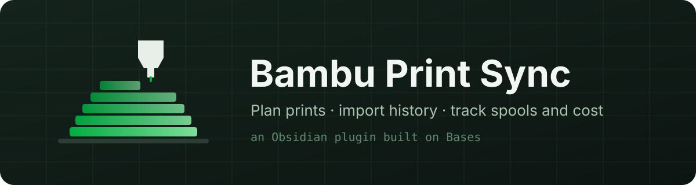
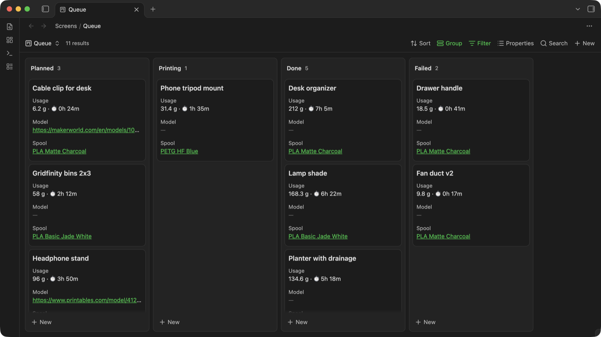
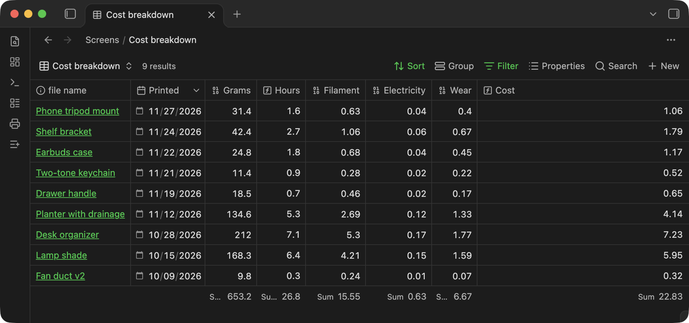
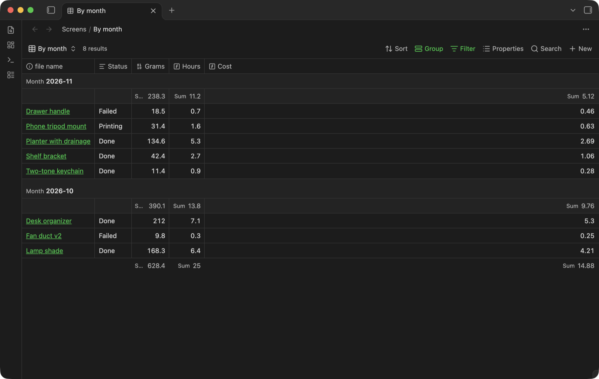
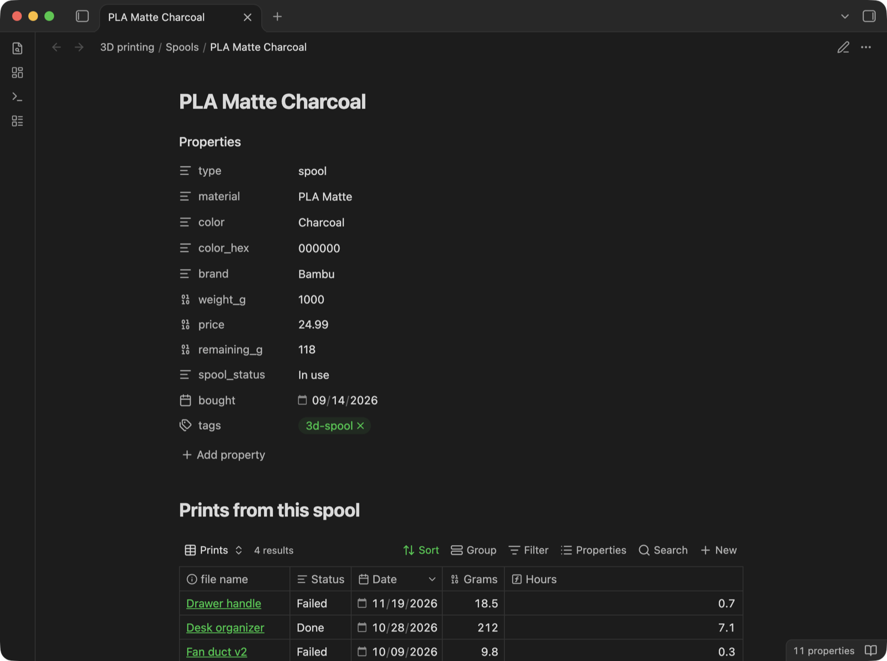
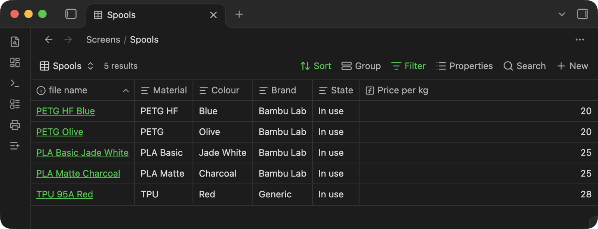
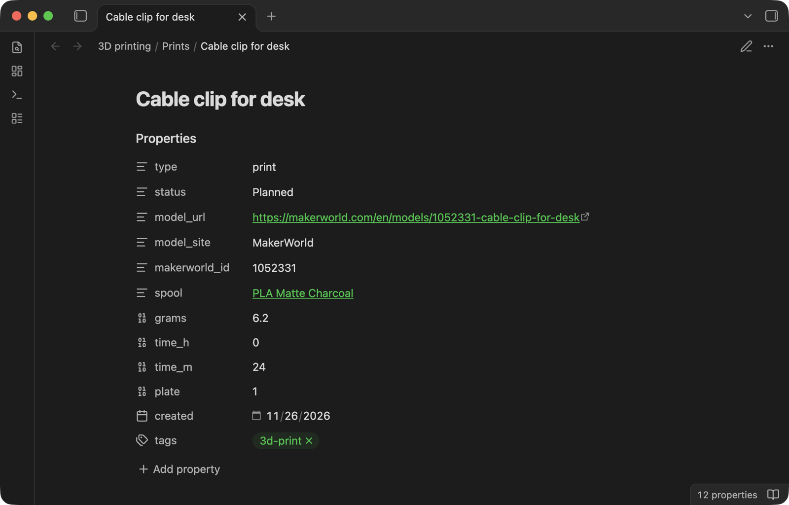
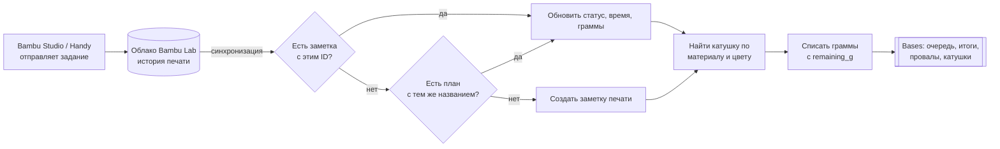

<p align="center">
  
</p>

<p align="center">
  <a href="https://github.com/grissspy/obsidian-bambu-print-sync/releases/latest"></a>
  
  
  <a href="LICENSE"></a>
  <a href="https://boosty.to/grispy/donate"></a>
</p>

<p align="center">
  <a href="README.md">English</a> · <b>Русский</b>
</p>

---

Журнал 3D-печати там же, где остальные заметки. **Bambu Print Sync** превращает каждую печать в заметку, подтягивает из облака Bambu Lab реальное время, расход пластика и результат и обновляет заметки катушек. Таблица [Bases](https://help.obsidian.md/bases) показывает очередь, стоимость и остаток пластика.

## Возможности

| | |
|---|---|
| 🗂 **Очередь печати** | Планируешь печати заметками и видишь их на доске: План → Печатается → Готово / Провал. |
| 📎 **Очередь по ссылке** | Нажми **«Добавить модель»** над доской, вставь ссылку с MakerWorld, Printables, Thingiverse или Cults3D, и в очереди появится запланированная печать с картинкой модели. |
| 💰 **Расходы на виду** | Панель печати открывается плитками: потрачено всего, в этом месяце, в прошлом и на провалы, плюс число печатей, килограммы и часы. |
| 🎨 **Катушки по цвету** | «Новая катушка» показывает плитками материалы и цвета, которыми принтер реально печатал; выбери плитку или материал из списка и цвет в палитре. При добавлении модели катушку тоже можно выбрать по цвету. |
| 🖼 **Картинки моделей** | На карточках видна картинка модели со страницы, а после печати превью пластины из облака Bambu. |
| ☁️ **История из облака** | Импорт заданий из аккаунта Bambu Lab: название, статус, время, граммы по каждому пластику, пластина, принтер. |
| 🔗 **План ↔ факт** | Задание связывается с запланированной заметкой по ID модели MakerWorld или по названию, дубль не создаётся. |
| 🧵 **Катушки** | Находит катушку по материалу и цвету AMS (цвет, выбранный вручную, совпадает по названию: «Чёрный» = «Чёрный»), делит многоцветную печать между катушками и списывает граммы один раз. |
| 💸 **Полная стоимость печати** | Пластик + электричество + амортизация принтера + обслуживание, записывается в каждую печать. Выбираешь модель принтера Bambu Lab, и подставляется её типичная мощность. |
| ❌ **Провалы** | Для отменённого задания облако отдаёт полный вес по нарезке. Плагин уменьшает его пропорционально тому, сколько задание шло, относительно оценки слайсера, считает только реальное время и помечает граммы как оценку (`grams_estimated`). Задание, отменённое до старта, ничего не стоит; без оценки слайсера остаётся полный вес как верхняя граница. Прогрев и калибровка считаются печатью, поэтому очень ранние сбои немного завышены; если знаешь точные граммы, впиши их руками, синхронизация их не перезапишет. |
| 🌍 **Русский и английский** | Язык как у Obsidian, названия статусов настраиваются. |

## Скриншоты

<p align="center"></p>

<p align="center"></p>

<table>
  <tr>
    <td width="50%"><br><sub><b>По месяцам</b>: граммы, часы и стоимость.</sub></td>
    <td width="50%"><br><sub><b>Катушка</b>: остаток и все печати с неё.</sub></td>
  </tr>
  <tr>
    <td width="50%"><br><sub><b>Катушки</b>: остаток, цена за кг, предупреждение.</sub></td>
    <td width="50%"><br><sub><b>По ссылке</b>: печать, созданная вставкой ссылки MakerWorld.</sub></td>
  </tr>
</table>

<sub>На скриншотах демо-хранилище с примерами (интерфейс на английском).</sub>

## Как это работает



Заметки остаются обычным Markdown со свойствами. Плагин читает и пишет только свойства из таблиц ниже и не трогает завершённую печать, которую ты поправил руками.

## Быстрый старт

1. Установи плагин (Сторонние плагины → Обзор → *Bambu Print Sync*) или положи `main.js`, `manifest.json` и `styles.css` из [последнего релиза](https://github.com/grissspy/obsidian-bambu-print-sync/releases/latest) в `.obsidian/plugins/bambu-print-sync/`.
2. В настройках плагина нажми **Войти** и введи email и пароль Bambu Lab. Если Bambu пришлёт код на почту, плагин его спросит.
3. При первом запуске плагин предложит создать папки печатей и катушек, базу учёта (`База печатей.base`) и заметку **«Панель печати»**: сверху кнопки, под ними доска. Если отказался, потом есть команда **«Создать панель печати»**.
4. Укажи **Импортировать печати начиная с** сегодняшней датой, если не нужна вся история, и заполни раздел **Стоимость печати** (ниже).
5. Ставь модели в очередь кнопкой **«Добавить модель»** на панели (или значком ➕ на боковой панели) и вставляй ссылку.
6. Добавь катушки командой **Новая катушка**: `material`, `color_hex`, `price`, `weight_g`.
7. Нажми иконку принтера на боковой панели или дождись автосинхронизации.

### Команды

| Команда | Что делает |
|---|---|
| Синхронизировать печати из облака | Импортирует новые задания, обновляет идущие и списывает пластик. |
| Списать пластик с катушек | Списывает готовые и проваленные печати с катушкой, которые ещё не списаны. Работает и для ручных заметок. |
| Добавить модель в очередь по ссылке | Создаёт запланированную печать по ссылке с MakerWorld, Printables, Thingiverse или Cults3D. |
| Новая печать | Создаёт заметку печати с нужными свойствами в заданной папке. |
| Новая катушка | Открывает окно катушки: плитки цветов из твоих печатей, список материалов, палитра, бренд, вес и цена. |
| Выбрать катушку для этой печати | Выбрать катушку по цвету для открытой заметки печати. |
| Привязать катушки к печатям без катушки | Проставляет катушку печатям, у которых её нет. У готовых печатей граммы не списываются. Новая катушка делает это сама. |
| Создать панель печати | Создаёт заметку с плитками расходов и кнопками **«Добавить модель»**, **«Синхронизировать»** и **«Пустая карточка»** над встроенной таблицей. |
| Создать базу учёта | Пишет файл Bases с видами Очередь, Все печати, По месяцам, Провалы, Стоимость и Катушки. |
| Пересчитать стоимость всех печатей | Пересчитывает стоимость каждой печати по текущим тарифам. |
| Войти в аккаунт Bambu | Открывает окно входа. |

## Свойства заметок

<details open>
<summary><b>Печать</b> (<code>type: print</code>)</summary>

| Свойство | Пример | Кто заполняет |
|---|---|---|
| `status` | `План`, `Печатается`, `Готово`, `Провал` | ты или синхронизация |
| `spool` | `"[[PLA Basic Чёрный]]"` | ты, или синхронизация при однозначном совпадении |
| `grams` | `42.4` | ты или синхронизация |
| `time_h`, `time_m` | `2`, `40` | ты или синхронизация (фактическое время после окончания) |
| `printed` | `2026-11-26` | синхронизация |
| `plate` | `1` | ты или синхронизация |
| `filaments` | `PLA #000000 — 42.4 g` | синхронизация |
| `usage` | `"[[PLA Basic Чёрный]]: 30"` | синхронизация, для многоцветной печати |
| `grams_estimated` | `true` | синхронизация, для провалов |
| `model_url`, `model_site`, `makerworld_id` | `https://makerworld.com/…` | «Добавить модель» или синхронизация |
| `cover` | `[[bambu-123.png]]` | страница модели или облако Bambu |
| `bambu_task_id`, `bambu_title`, `printer`, `time_est_min`, `source` | | синхронизация |
| `spool_deducted` | `true` | плагин после списания |
| `price_kg` | `1990` | ты, если нужно переопределить цену катушки |
| `cost_filament`, `cost_power`, `cost_wear`, `cost` | `85`, `5`, `54`, `144` | плагин |

</details>

<details open>
<summary><b>Катушка</b> (<code>type: spool</code>)</summary>

| Свойство | Пример | Примечание |
|---|---|---|
| `material` | `PLA Basic` | Первое слово сравнивается с типом пластика в AMS. |
| `color_hex` | `000000` | Цвет из AMS без `#`. Пусто — сравнение только по материалу. |
| `weight_g` | `1000` | Вес пластика на полной катушке. |
| `price` | `1990` | Цена катушки. |
| `remaining_g` | `870` | Обновляет плагин. |
| `spool_status` | `Открыта`, `Пустая` | Пустые катушки не подбираются. |

</details>

### Как задание находит запланированную заметку

Заметка, созданная по ссылке MakerWorld, связывается по ID модели, это точное совпадение. Иначе заметка в статусе «План» или «Печатается» связывается, если её имя совпадает с названием задания после нормализации: нижний регистр, без `.3mf`, `plate N`, подчёркиваний и дефисов. `Shelf_bracket.3mf` совпадёт с заметкой `Shelf bracket`. Если заметка называется иначе, впиши облачное название в `bambu_title`.

### Стоимость печати

Тарифы задаются один раз в настройках:

| Настройка | Пример | Для чего |
|---|---|---|
| Модель принтера | Bambu Lab P2S · ~130 Вт | подставляет среднюю мощность; поправь, если измерял свой |
| Цена электричества за кВт·ч | `7` | `часы × Вт ÷ 1000 × цена` |
| Цена принтера, ресурс в часах | `90000`, `4000` | амортизация: `часы × цена ÷ ресурс` |
| Обслуживание за час | `5` | сопла, столы, ремни, смазка |
| Символ валюты | `₽` | показывается на карточках очереди |

```
стоимость = граммы × цена за кг ÷ 1000                  (пластик; для многоцветной печати по каждой катушке)
          + часы × Вт ÷ 1000 × цена кВт·ч                (электричество)
          + часы × (цена принтера ÷ ресурс + обслуживание за час)   (износ)
```

Плагин записывает `cost_filament`, `cost_power`, `cost_wear` и `cost` в печать каждый раз, когда меняются граммы, время или катушка. Когда печать готова или провалена, её стоимость больше не меняется, так что новый тариф на электричество не переписывает историю; для этого есть команда **Пересчитать стоимость всех печатей**. В настройках видна стоимость часа работы принтера. Мощность моделей — типичные средние значения, а не замеры.

### Очередь по ссылке

Нажми **«Добавить модель»** на панели печати (или значок ➕ на боковой панели, или команду «Добавить модель в очередь по ссылке») и вставь ссылку. Плагин узнаёт страницы MakerWorld, Printables, Thingiverse и Cults3D, берёт название модели из адреса (или со страницы, если в ссылке его нет, как в `/models/12703`) и создаёт запланированную печать со ссылкой. Повторное добавление той же модели не создаёт вторую карточку, пока первая в очереди.

Кнопки можно поставить в любую заметку:

````markdown
```bambu-print-sync
```
````

Хочешь вставлять ссылки прямо в заметки? Включи в настройках «Ставить в очередь по вставленной ссылке»: тогда ссылка на модель, вставленная в любую заметку, тоже создаст карточку.

**Картинки.** Плагин сохраняет картинку, которую страница модели отдаёт для превью ссылок, в папку `Картинки` рядом с заметками и показывает её на карточке очереди. Некоторые сайты блокируют автоматические запросы; тогда карточка остаётся без картинки до печати, а после неё берётся превью пластины из облака Bambu. Выключи «Картинки моделей», если это не нужно. Импортированные печати тоже получают ссылку на модель MakerWorld, если облако её знает. Граммы и время придут из облака после печати или ты впишешь их после нарезки.

## Вместе с синхронизацией хранилища

Obsidian Sync, Seafile, iCloud, Syncthing и похожие инструменты копируют заметки между устройствами. Плагин рассчитан на работу рядом с ними:

- **Пишет одно устройство.** Импорт из облака Bambu, списание пластика и расчёт стоимости делает только **основное устройство**. Переключатель стоит первым в настройках плагина, есть и команда *«Сделать это устройство основным»*. Компьютеры основные по умолчанию, телефоны нет. Переключатель хранится на самом устройстве и не меняется, даже если настройки плагинов синхронизируются. Основным делай ровно одно устройство; телефон тоже подходит, но синхронизирует, только пока Obsidian открыт.
- **Двух основных не бывает.** Каждое устройство ведёт маленькую служебную заметку в папке `Устройства` рядом с заметками и пишет только в свою, поэтому синхронизации хранилища нечего склеивать. Если включить переключатель, пока другое устройство активно работает основным, плагин сначала спросит; другое устройство само станет неосновным, когда в следующий раз соберётся импортировать, ещё ничего не тронув. В настройках видно, какое устройство основное и когда оно синхронизировалось.
- **Отсутствие основного не пройдёт незамеченным.** Если основного устройства нет или оно не синхронизировалось два дня, остальные устройства покажут предупреждение (раз в день) с кнопкой «Сделать основным». Основное устройство без входа в аккаунт тоже предупредит.
- **Ждёт синхронизацию.** Первая синхронизация с Bambu после запуска Obsidian откладывается (по умолчанию на 30 секунд), чтобы сначала пришли заметки с других устройств.
- **Дубли убираются сами.** Если всё же появятся две копии одного задания, плагин оставит ту, с которой уже списан пластик, или самую старую, а вторую уберёт в корзину.
- **Правки маленькие.** Плагин меняет только свойства в шапке заметки и только когда значение действительно изменилось, поэтому синхронизации почти нечего сливать и нет циклов правок между устройствами.

Добавлять модели можно на любом устройстве: это действие, которое ты делаешь руками.

## Приватность и сеть

Плагину нужен **аккаунт Bambu Lab**, и он обращается к **облаку Bambu Lab** через интернет:

- `api.bambulab.com` (или `api.bambulab.cn` для китайских аккаунтов): вход, список принтеров, история печати;
- `bambulab.com/api/sign-in/tfa`: только если включена двухфакторная защита;
- CDN Bambu: скачать превью пластин твоих печатей (если включены «Картинки моделей»).

Когда добавляешь модель по ссылке, плагин один раз открывает **эту страницу модели** (MakerWorld, Printables, Thingiverse или Cults3D), чтобы прочитать картинку для превью, и скачивает её. Этим сайтам ничего не передаётся, кроме обычного запроса страницы. Выключи «Картинки моделей», чтобы этого не было.

Пароль один раз отправляется в Bambu Lab для получения токена и **нигде не сохраняется**. Токен (около трёх месяцев) хранится в `.obsidian/plugins/bambu-print-sync/data.json` внутри хранилища и синхронизируется вместе с ним. Других данных плагин никуда не отправляет: ни телеметрии, ни аналитики, ни сторонних серверов.

> [!WARNING]
> Облачный API Bambu Lab не публичный и не документирован производителем. Он может измениться или перестать работать в любой момент. Если вход не проходит, токен можно вставить вручную в настройках.

## Вопросы

**Работает без облака?**
Да. Создавай заметки печатей и катушек сам и запускай «Списать пластик с катушек», база работает так же. Принтеры в режиме LAN-only не синхронизируются.

**Импортирует всю историю?**
По умолчанию запрашиваются последние 50 заданий. «Импортировать печати начиная с» задаёт дату начала.

**Меняет ли заметку после окончания печати?**
Нет. Когда задание в заметке завершено, плагин её не трогает, твои правки остаются.

**Можно свои названия статусов?**
Да, в разделе «Названия статусов» в настройках. Создаваемая база тоже их использует.

## Разработка

Плагин написан на чистом JavaScript без сборки: Obsidian загружает `main.js` напрямую.

```bash
npm test
```

Тест прогоняет синхронизацию и списание на поддельном хранилище и поддельном облаке. Для релиза подними `version` в `manifest.json` и `versions.json` и запушь тег с тем же номером: workflow сам приложит `main.js`, `manifest.json` и `styles.css` к релизу на GitHub.

## Поддержать

Если плагин экономит тебе время, можно поддержать разработку на [Boosty](https://boosty.to/grispy/donate). Туда же ведёт кнопка «Поддержать» на странице плагина в Obsidian.

## Отказ от ответственности

Проект не связан с Bambu Lab и не поддерживается ею. «Bambu Lab» — товарный знак своего владельца.

## Лицензия

[MIT](LICENSE)
